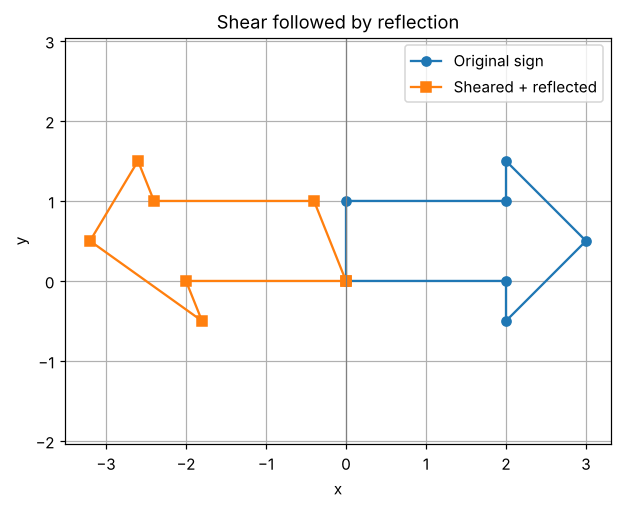

# Task 5: Matrix Algebra

Files: code/original/Task_05_matrix_algebra.py, code/parameter_change/Task_05_matrix_algebra_param.py, code/modified/Task_05_modified_shear_reflect.py

## B. Input values and operation

The inputs are the 4 corners of a unit square, a rotation of 45 degrees and a scaling matrix that stretches x by 2 and y by 1.5. The rotation and scaling matrices are multiplied together into one transformation matrix. This matrix is applied to all the points with points @ T.T. Finally the program finds the determinant of the matrix.

## C. Changing an input

I changed the angle to 90 degrees and the y scale to 0.5.

| Result | Original | After change |
|---|---|---|
| Point (1,1) moves to | (0.354, 2.475) | (-0.5, 2.0) |
| Determinant | 3.0 | 1.0 |

The determinant is the rotation's determinant (always 1) times the scale's determinant (2 x 0.5 = 1). So the area stayed the same, even though the square became a long thin rectangle. Some values print as very small numbers like 1.2e-16 instead of 0, because cos(90) is not stored exactly.

## D. Meaning of the output

The square was stretched to 2 by 1.5 and then turned 45 degrees. A determinant of 3 means the new shape has 3 times the area of the old one. The value 2.9999999999999996 is just rounding error. This is the same kind of calculation used in computer graphics to move and resize shapes.

## E. Modified program: shear and reflection of a road sign

I used other types of matrices on an arrow shape.

Assumptions: the arrow is drawn with 8 points. A shear x' = x + 0.4y is applied, which makes it slant like italic writing. It is then reflected (mirrored) about the y-axis.

Input data: the arrow points, the shear matrix and the reflection matrix.

Output: the combined matrix is [[-1, -0.4], [0, 1]] and the determinant is -1. The area is 3.0 both before and after.

Interpretation: the area did not change because the size of the determinant is 1. The minus sign shows the shape was flipped, so the arrow now points left. The graph shows the original arrow and the slanted, mirrored arrow.

