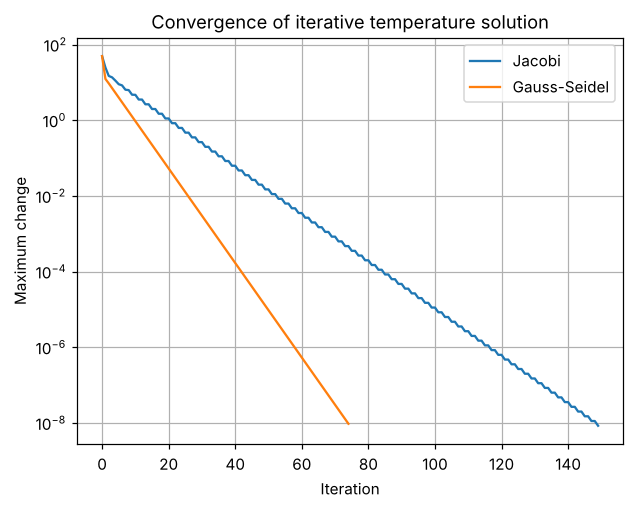
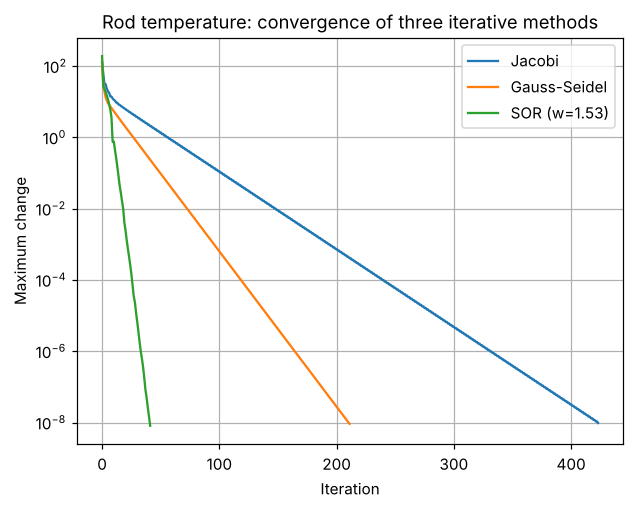

# Task 8: Iterative Methods (Jacobi and Gauss-Seidel)

Files: code/original/Task_08_iterative_linear.py, code/parameter_change/Task_08_iterative_linear_param.py, code/modified/Task_08_modified_rod_sor.py

## B. Input values and operation

A 5 by 5 matrix (2 on the diagonal and -1 next to it) models heat at 5 points along a bar. The left end is 100 C and the right end is 20 C. The system is solved with two iterative methods:

- Jacobi uses only the values from the previous round.
- Gauss-Seidel uses each new value as soon as it is worked out.

Both stop when the biggest change is less than 1e-8.

## C. Changing an input

I changed the left end to 60 C and printed the number of iterations.

| Result | Original (100 C) | After change (60 C) |
|---|---|---|
| Temperatures | 86.7, 73.3, 60, 46.7, 33.3 | 53.3, 46.7, 40, 33.3, 26.7 |
| Jacobi iterations | 150 | 148 |
| Gauss-Seidel iterations | 75 | 74 |

The temperatures still go down in equal steps, now 6.67 C each. The number of iterations hardly changed. How fast the methods converge depends on the matrix, not on the end temperatures.

## D. Meaning of the output and graph

When the bar has settled, the temperature falls in a straight line from the hot end to the cold end. On the graph both lines are straight because the y-axis is logarithmic, so the error gets smaller by the same factor every step. The Gauss-Seidel line is steeper, and it needed half as many iterations as Jacobi.

## E. Modified program: hot rod in a jiko, adding SOR

Assumptions: a rod with 9 inside points has one end in a jiko at 250 C and the other end at room temperature, 25 C. I also added SOR (successive over-relaxation) with omega = 1.528.

Input data: a 9 by 9 matrix and the two end temperatures.

Output: the temperatures go from 227.5 C down to 47.5 C in steps of 22.5 C. Jacobi needed 424 iterations, Gauss-Seidel 212 and SOR only 42.

Interpretation: with more points, Jacobi and Gauss-Seidel become much slower. SOR was about 5 times faster than Gauss-Seidel, which would help a lot in bigger problems. The graph shows the SOR line dropping the fastest.

