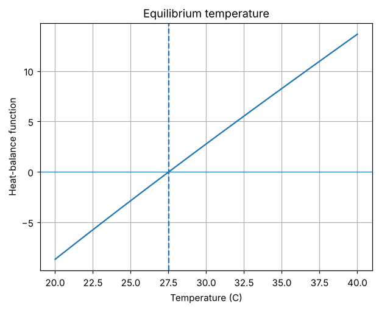
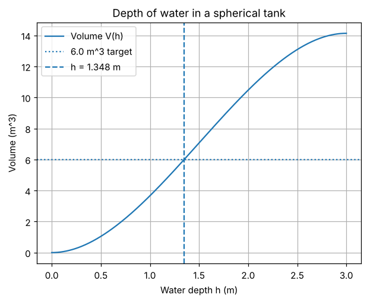

# Task 10: Bisection and Fixed-Point Iteration

Files: code/original/Task_10_bisection_fixed_point.py, code/parameter_change/Task_10_bisection_fixed_point_param.py, code/modified/Task_10_modified_water_tank.py

## B. Input values and operation

The function f(T) = T - 25 - 10e^(-T/20) gives the heat balance of an object. The equilibrium temperature is where f(T) = 0.

- Bisection starts with the interval 20 to 40 and keeps halving it.
- Fixed-point iteration starts at T = 30 and keeps applying T = 25 + 10e^(-T/20) until the value stops changing.

## C. Changing an input

I changed the surrounding temperature from 25 C to 30 C.

| Result | Original | After change |
|---|---|---|
| Equilibrium temperature | 27.525 C | 32.017 C |
| Fixed-point iterations | 13 | 12 |

The equilibrium went up by about 4.5 C and not the full 5 C. This is because the extra heat term gets smaller at higher temperatures. Fixed-point iteration still worked because the slope of the function is small (about 0.1), which is less than 1.

## D. Meaning of the output and graph

The object settles at 27.53 C, where the heat it gains equals the heat it loses. Both methods give the same answer. The graph shows the curve crossing zero only once (at the dashed line), so there is only one equilibrium temperature between 20 C and 40 C.

## E. Modified program: water depth in a round tank

Assumptions: a spherical water tank has a radius of 1.5 m. The volume at depth h is V = pi h^2 (3r - h)/3. I want the depth when the tank holds 6000 litres (6 cubic metres).

Input data: radius 1.5 m, target volume 6.0 cubic metres, bracket 0 to 3 m.

Output: the depth is 1.348 m. Bisection took 35 iterations and fixed-point took 16. The full tank holds 14.14 cubic metres.

Interpretation: the 6000 litre mark should go at about 1.35 m on the gauge. A round tank is widest in the middle, so the volume does not go up evenly with the depth. The graph shows the volume curve crossing the 6 cubic metre line.

