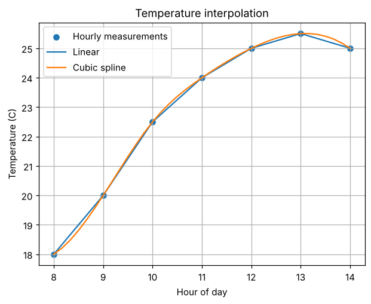
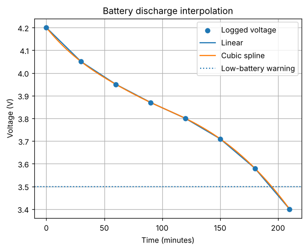

# Task 13: Interpolation

Files: code/original/Task_13_interpolation.py, code/parameter_change/Task_13_interpolation_param.py, code/modified/Task_13_modified_battery.py

## B. Input values and operation

The inputs are temperatures measured every hour from 8:00 to 14:00. The program estimates the temperature between the readings in two ways. Linear interpolation joins the points with straight lines. A cubic spline draws a smooth curve through them. Both are worked out every 10 minutes and at 10:30.

## C. Changing an input

I removed the 11:00 reading, as if the sensor had failed.

| Estimate at 10:30 | Original | After change |
|---|---|---|
| Linear | 23.25 C | 23.12 C |
| Cubic spline | 23.36 C | 23.43 C |

Linear interpolation now draws a straight line from 10:00 to 12:00, so its estimate dropped. The spline changed less because it uses the shape of the nearby points. Missing data affects linear interpolation more.

## D. Meaning of the output and graph

At 10:30 the temperature was about 23.3 C. On the graph the linear line has sharp corners at each reading. The spline is smooth and curves over near 13:00, where the temperature is highest. The two methods are very close to each other.

## E. Modified program: phone battery

Assumptions: the battery voltage is recorded every 30 minutes and falls from 4.20 V to 3.40 V. The phone shows a low battery warning at 3.50 V.

Input data: 8 readings over 210 minutes.

Output: both methods give 3.847 V at 100 minutes. The battery reaches 3.50 V at 193.3 minutes (linear) or 194.5 minutes (cubic).

Interpretation: on the flat middle part of the curve both methods agree. Near the end, where the voltage drops faster, they differ by about a minute. The warning would show about 3 hours and 15 minutes after a full charge.

