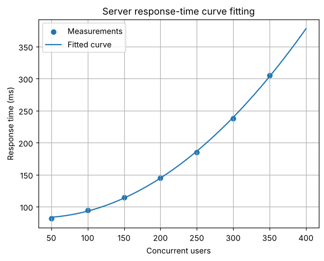
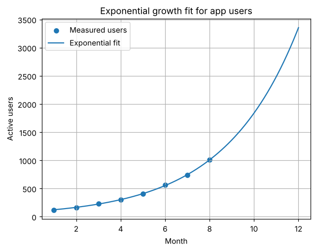

# Task 14: Curve Fitting

Files: code/original/Task_14_curve_fitting.py, code/parameter_change/Task_14_curve_fitting_param.py, code/modified/Task_14_modified_app_growth.py

## B. Input values and operation

There are 7 measurements of server response time (ms) for 50 to 350 users. curve_fit finds the best values of a, b and c for y = ax^2 + bx + c using least squares. The program then finds the RMSE (the average size of the error) and predicts the response time for 400 users.

## C. Changing an input

I changed the last reading (350 users) from 305 ms to 340 ms.

| Result | Original | After change |
|---|---|---|
| Model | 0.002167x^2 - 0.1345x + 85.00 | 0.003000x^2 - 0.3929x + 100.00 |
| RMSE | 1.55 ms | 7.79 ms |
| Prediction at 400 users | 377.86 ms | 422.86 ms |

Changing just one point made the error 5 times bigger and moved the prediction by 45 ms. Least squares is easily affected by one bad reading, especially at the end of the data.

## D. Meaning of the output and graph

Response time goes up faster and faster as more users join. With 400 users it should be about 378 ms. On the graph the curve passes very close to all the points and bends upwards after 350 users. This is a warning that the server will slow down a lot.

## E. Modified program: growth of a campus app

Assumptions: the number of active users of a new app is recorded for 8 months (sample data). The growth looks exponential, so I used the model N = N0 e^(rt).

Input data: months 1 to 8, with users going from 120 to 1010.

Output: N = 91.11 e^(0.3005t). Users grow about 35% each month and double about every 2.3 months. The RMSE is 4.05 users. The prediction for month 12 is 3,355 users.

Interpretation: the app is growing fast, so the servers should be ready for more than 3,000 users within a year. Growth like this cannot go on forever, so the prediction is only good for the next few months.

