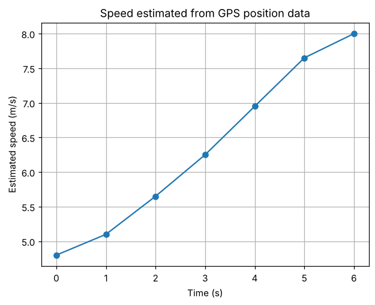
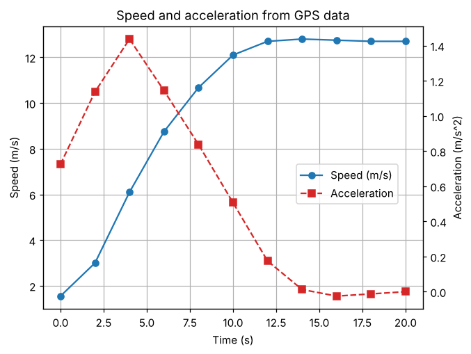

# Task 15: Numerical Differentiation

Files: code/original/Task_15_numerical_differentiation.py, code/parameter_change/Task_15_numerical_differentiation_param.py, code/modified/Task_15_modified_acceleration.py

## B. Input values and operation

The inputs are GPS positions taken every second for 6 seconds. Speed is the change in position divided by the change in time. The program uses:

- a forward difference at the first point,
- central differences for the middle points,
- a backward difference at the last point.

## C. Changing an input

I changed the position at t = 3 s from 16.1 m to 17.5 m, like a GPS error.

| Time | Original speed | After change |
|---|---|---|
| 2 s | 5.65 m/s | 6.35 m/s |
| 3 s | 6.25 m/s | 6.25 m/s |
| 4 s | 6.95 m/s | 6.25 m/s |

The speed at 3 s did not change, because the central difference does not use the middle point. The speeds at 2 s and 4 s changed instead, so the smooth increase now has a bump. Small errors in position give bigger errors in speed.

## D. Meaning of the output and graph

The vehicle sped up from 4.8 m/s to 8.0 m/s in 6 seconds. The line on the graph is almost straight, so the acceleration was nearly constant at about 0.5 m/s^2.

## E. Modified program: matatu leaving a stage

Assumptions: GPS positions of a matatu are recorded every 2 seconds for 20 seconds. I used np.gradient twice, first to get the speed and then the acceleration.

Input data: 11 positions from 0 m to 197.4 m.

Output: the top speed was 46.1 km/h. The highest acceleration was 1.44 m/s^2 at 4 seconds. After about 14 seconds the acceleration was almost 0.

Interpretation: the matatu speeds up hard in the first few seconds and then keeps a steady speed of about 46 km/h. On the graph the speed line flattens at the same time as the acceleration drops to zero.

