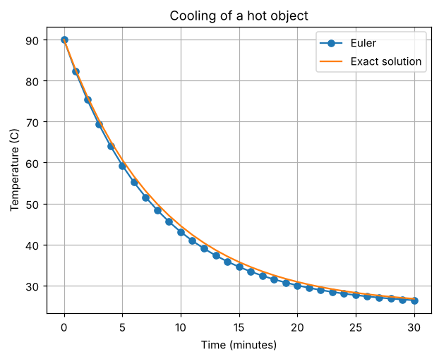
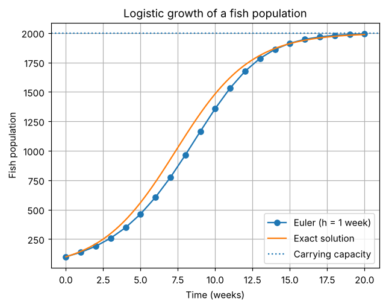

# Task 17: Euler's Method

Files: code/original/Task_17_euler_ode.py, code/parameter_change/Task_17_euler_ode_param.py, code/modified/Task_17_modified_logistic.py

## B. Input values and operation

The inputs are a room temperature of 25 C, a starting temperature of 90 C, k = 0.12, a step of 1 minute and a time of 30 minutes. Newton's law of cooling dT/dt = -k(T - 25) is solved step by step with Euler's method: new T = old T + step x rate. The answer is compared with the exact formula.

## C. Changing an input

I made the step smaller, from 1 minute to 0.25 minutes.

| Result | Step 1 min | Step 0.25 min |
|---|---|---|
| Euler at 30 min | 26.40 C | 26.68 C |
| Exact at 30 min | 26.78 C | 26.78 C |
| Error | 0.372 C | 0.095 C |

When the step was 4 times smaller, the error became about 4 times smaller. This is expected because Euler's method is first order. The cost is that 4 times as many steps were needed.

## D. Meaning of the output and graph

The hot object cools quickly at first and then more slowly as it gets close to room temperature. After 30 minutes it is about 26.8 C. On the graph the Euler points are a little below the exact curve, because each step uses the slope from the start of the step.

## E. Modified program: fish in a pond

Assumptions: a pond is stocked with 100 fish and can hold at most 2,000. The growth rate is 0.4 per week. I used the logistic equation dP/dt = rP(1 - P/K) for 20 weeks and tried steps of 1, 0.5 and 0.1 weeks.

Input data: r = 0.4, K = 2000, starting population 100.

Output: the largest errors were 163.4 fish (step 1), 82.3 fish (step 0.5) and 16.6 fish (step 0.1). The exact number after 20 weeks is 1,987 fish.

Interpretation: the population grows in an S shape and is close to the limit of 2,000 after about 15 weeks. A step of 1 week gives large errors while the fish are growing fastest, so a smaller step is needed.

