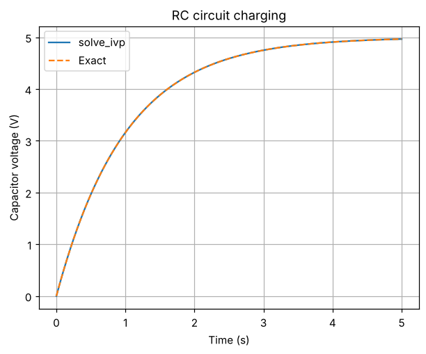
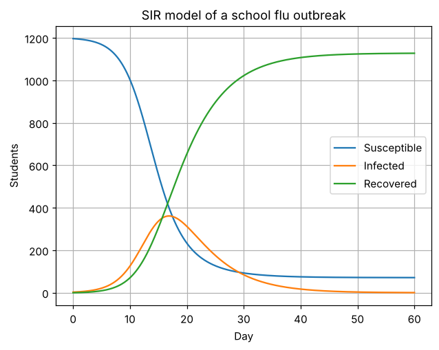

# Task 18: Solving ODEs with SciPy

Files: code/original/Task_18_scipy_ode.py, code/parameter_change/Task_18_scipy_ode_param.py, code/modified/Task_18_modified_sir.py

## B. Input values and operation

The inputs are a 5 V supply, a resistance of 1000 ohms, a capacitance of 0.001 F and a starting voltage of 0. The equation dV/dt = (Vs - V)/(RC) for a charging capacitor is solved with solve_ivp from 0 to 5 seconds. The answer is compared with the exact formula Vs(1 - e^(-t/RC)).

## C. Changing an input

I doubled the resistance to 2000 ohms.

| Result | R = 1000 | R = 2000 |
|---|---|---|
| Voltage at 5 s | 4.9663 V | 4.5896 V |
| Maximum error | 9.3e-10 V | 6.7e-10 V |

RC went from 1 s to 2 s, so the capacitor charges more slowly. After 5 seconds it is only about 92% full instead of 99%. I checked 5(1 - e^-2.5) = 4.5896 V by hand and it matches.

## D. Meaning of the output and graph

The capacitor is almost fully charged (4.97 V out of 5 V) after 5 seconds. On the graph the solver line and the exact line lie on top of each other because the error is tiny. The voltage rises fast at first and then levels off.

## E. Modified program: flu in a boarding school (SIR model)

Assumptions: a school has 1,200 students and 3 are sick at the start. Each sick student infects 0.6 others per day, and students are sick for about 5 days (recovery rate 0.2). Students are grouped as Susceptible, Infected or Recovered.

Input data: N = 1200, beta = 0.6, gamma = 0.2, 60 days.

Output: the peak was 362 students sick at the same time, on about day 17. In total, 1,129 students (94%) caught the flu, and 71 never did. S + I + R stayed equal to 1,200, which is a good check.

Interpretation: if nothing is done, about 30% of the school would be sick at the same time in the third week. The school would need to plan for this in the sick bay. Lowering the infection rate, for example by isolating sick students, would make the peak smaller.

