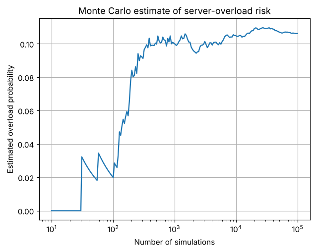
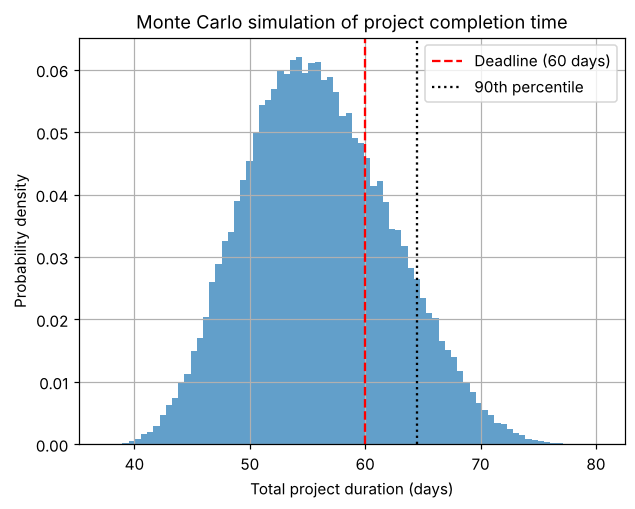

# Task 20: Monte Carlo Simulation

Files: code/original/Task_20_monte_carlo.py, code/parameter_change/Task_20_monte_carlo_param.py, code/modified/Task_20_modified_project_risk.py

## B. Input values and operation

The server capacity is 1000. Demand is random, with a mean of 850 and a standard deviation of 120. The program creates 100,000 random demand values and counts how many are above the capacity. That fraction is the probability of overload. It also plots how the estimate changes as more samples are added.

## C. Changing an input

I raised the capacity from 1000 to 1100.

| Result | Capacity 1000 | Capacity 1100 |
|---|---|---|
| Simulated overload chance | 10.616% | 1.912% |
| Value from the normal table | 10.565% | 1.861% |

Adding 10% more capacity made overload more than 5 times less likely. The simulated answers are very close to the values from the normal distribution table.

## D. Meaning of the output and graph

The server would be overloaded about 10.6% of the time, which is roughly 1 day in 9. On the graph the estimate jumps around when there are only a few samples. It settles at about 0.106 after around 10,000 samples. More samples give a more accurate answer.

## E. Modified program: will a project finish on time?

Assumptions: a student software project has three stages done one after the other. Each stage has a shortest, most likely and longest time:
- design: 8, 12 and 20 days
- coding: 20, 28 and 45 days
- testing and report: 7, 10 and 18 days

The deadline is 60 days. I ran 100,000 simulations.

Input data: the three time ranges and the deadline.

Output: on average the project takes 56.0 days. The chance of missing the deadline is 26.3%. To be 90% sure of finishing, 64.5 days are needed.

Interpretation: the most likely times only add up to 50 days, but delays push the average to 56 days. The project will be late about 1 time in 4. The team should start about 5 days earlier or cut some of the coding work, since coding has the biggest range.

